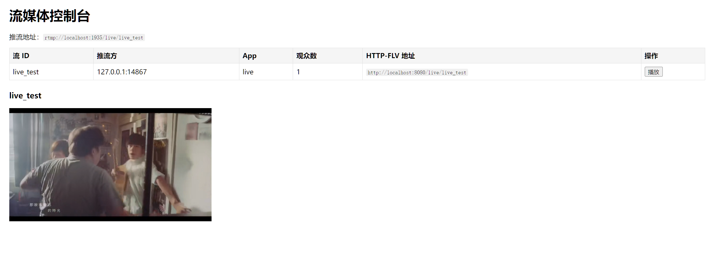

# rust-flv-server

一个用 Rust 写的轻量流媒体服务器：**RTMP 推流，HTTP-FLV 拉流**，附带一个 Web 控制台。

推流端用 OBS / ffmpeg 往 1935 端口推 RTMP，浏览器端通过 HTTP-FLV 拉流播放，
不需要 RTMP 插件，也不依赖 Flash。

## 特性

- **RTMP 推流**：监听 1935，支持流 key 鉴权
- **HTTP-FLV 拉流**：一个普通 HTTP 响应持续写 FLV 字节，前端挂 flv.js 即可播放
- **多观众**：一条流可以同时被多个客户端拉取，各自独立
- **新观众补发**：中途连入的客户端会先收到 SPS/PPS 和最近的关键帧，避免黑屏
- **Web 控制台**：列出当前所有流、推流方 IP、观众数，并可一键在线播放

## 效果演示



## 架构

```
ffmpeg / OBS
     │  RTMP (1935)
     ▼
┌─────────────────┐
│   RtmpHandler   │  on_publish / on_media_tag / on_unpublish
└────────┬────────┘
         │ 每个媒体 tag
         ▼
┌─────────────────┐
│      Hub        │  tokio::sync::broadcast，每个流一条通道
│  (广播 + 缓存)   │  缓存顺序头与最近关键帧，供新观众补发
└────────┬────────┘
         │ 订阅
         ▼
┌─────────────────┐
│  HTTP-FLV 端点  │  axum，Body::from_stream 边写边发
└────────┬────────┘
         │  HTTP (8080)
         ▼
    浏览器 + flv.js
```

核心是中间的 **Hub**：RTMP 的回调是“推送式”的（帧到了就调你），
HTTP 拉流是“拉取式”的（客户端按自己节奏读），两者节奏对不上，
中间必须有一层带缓冲的广播。

## 目录结构

```
rust-flv-server/
├── Cargo.toml
├── .env
├── src/
│   ├── main.rs       # 启动 RTMP + HTTP 两个服务
│   ├── hub.rs        # 广播中枢与流缓存
│   ├── flv.rs        # FlvTag -> FLV 字节流编码
│   └── handler.rs    # RTMP 回调实现
└── static/
    └── index.html    # Web 控制台
```

## 快速开始

### 1. 配置

`.env`：

```
RUST_LOG=info
RTMP_BIND=0.0.0.0:1935
HTTP_BIND=0.0.0.0:8080
```

### 2. 运行

```bash
cargo run
```

启动后会看到：

```
HTTP 控制台监听于 http://0.0.0.0:8080
RTMP 服务监听于 0.0.0.0:1935
```

### 3. 推流

```
ffmpeg -re -stream_loop -1 -i .\cmzw_h264.mp4 -c copy -f flv rtmp://localhost:1935/live/live_test
```

* 流 key 必须以 `live_` 开头
* **必须是 H.264**
* `-re` 不能省，它让 ffmpeg 按真实时间发送
* -stream_loop -1 循环推送，mp4播放完毕后重新播放


### 4. 观看

- 控制台：<http://localhost:8080>
- 直接拉流：<http://localhost:8080/live/live_test>

控制台里点“播放”即可在线观看。

## 接口

| 方法 | 路径 | 说明 |
|---|---|---|
| GET | `/api/streams` | 返回当前所有流的 JSON 列表 |
| GET | `/live/{key}` | HTTP-FLV 拉流端点 |
| GET | `/` | Web 控制台页面 |

`/api/streams` 返回示例：

```json
[
  {
    "stream_key": "live_test",
    "publisher": "127.0.0.1:52034",
    "app": "live",
    "viewers": 2,
    "flv_url": "http://localhost:8080/live/live_test"
  }
]
```

## 注意事项

### 视频必须是 H.264

**flv.js 只支持 H.264（AVC）视频，不支持 H.265 / HEVC。**
如果用 HEVC 编码的视频推流，浏览器控制台会报：

```
Flv: Unsupported codec in video frame: 1
```

推流前用 `ffprobe` 确认编码：

```bash
ffprobe test.mp4
```

`Video:` 一行应显示 `h264`。

### 流 key 规则

流 key 非空且以 `live_` 开头才会被接受，否则推流会被拒绝。
规则写在 `src/handler.rs` 的 `on_publish` 里，可以按需修改。

### 端口

- `1935`：RTMP 推流
- `8080`：HTTP 拉流与控制台

两个端口都在 `.env` 里配置。

## 依赖

| crate | 用途 |
|---|---|
| `rtmp-rs` | RTMP 服务端与协议解析 |
| `tokio` | 异步运行时 |
| `axum` | HTTP 服务与流式响应 |
| `tokio-stream` | 把 broadcast 接收端包成 Stream |
| `tower-http` | 静态文件服务 |
| `bytes` | 零拷贝字节缓冲 |
| `serde` / `serde_json` | 控制台 JSON 接口 |
| `tracing` / `tracing-subscriber` | 日志 |
| `dotenvy` | 读取 `.env` |

## 后续方向

- **HLS**：挂在同一个 `Hub` 上即可，广播层不用动
- **鉴权**：把 `on_publish` 里的规则换成查数据库或校验 token
- **录制**：在 `on_media_tag` 里把 tag 另存为 FLV 文件

